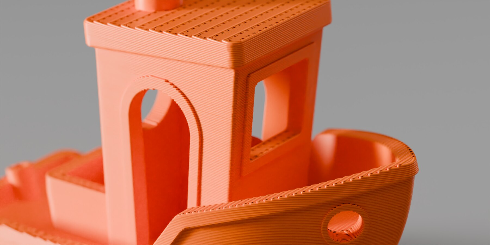
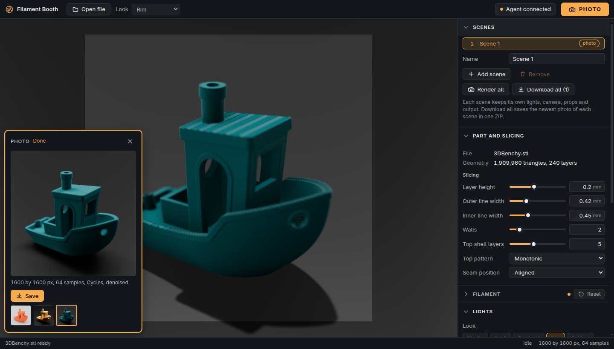
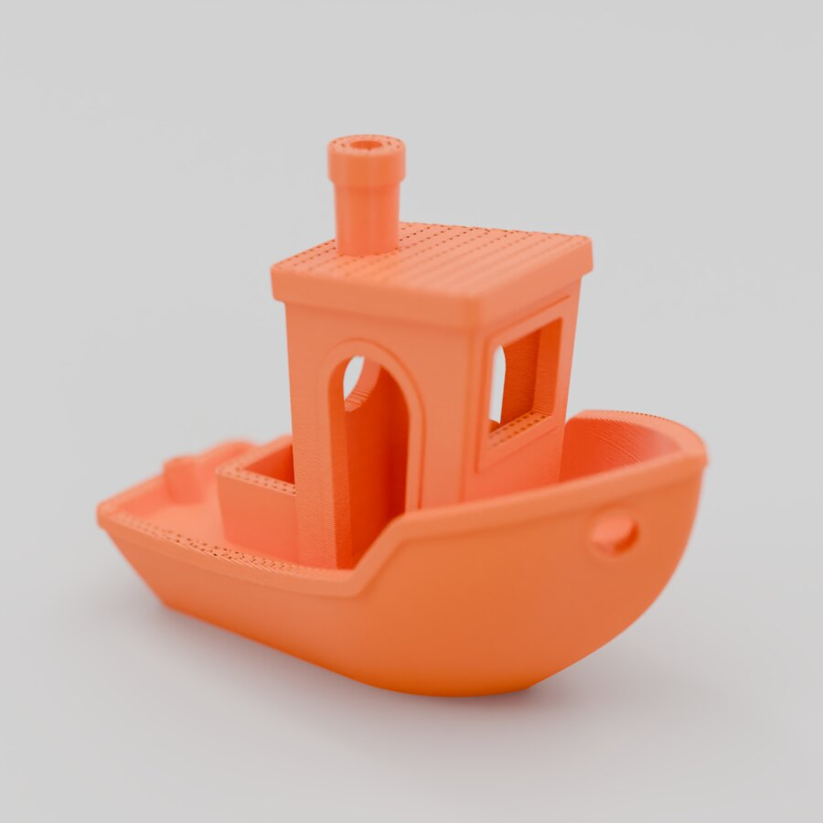
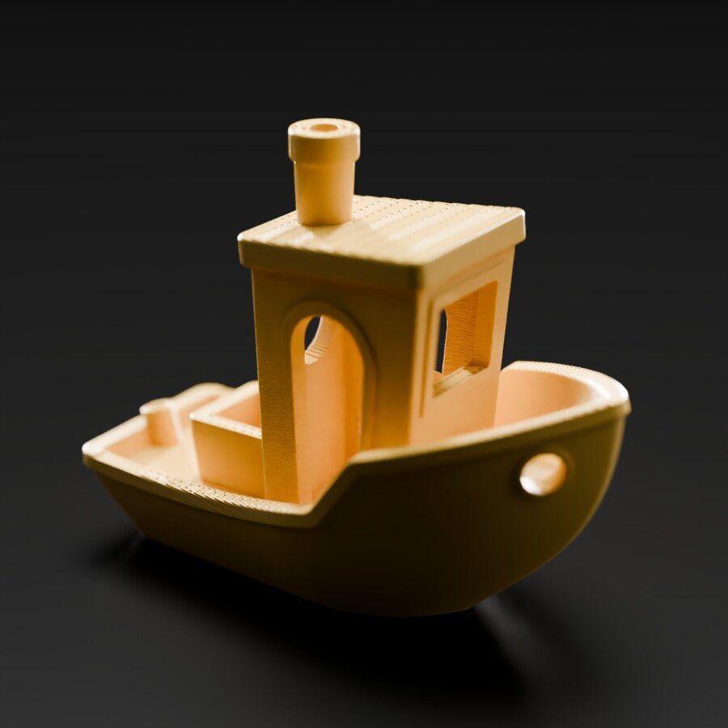
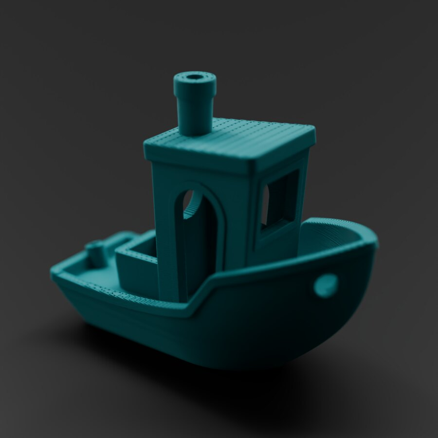

# Filament booth

Product photos of 3D-printed parts, made in a browser tab. Drop an STL or a G-code on
**[booth.artems.net](https://booth.artems.net)** and press PHOTO.



The tab slices the STL with OrcaSlicer's engine, builds the print bead by bead, and path traces it
with Blender's Cycles. Both run in WebAssembly, so no file leaves your computer and there is
nothing to install. The layer lines above are the toolpath of a 0.2 mm print.

Opening a part frames it and chooses a default aperture (`f/`) for its size so small prints stay in
focus front to back. Photos develop through Blender's AgX with subtle camera optics on by default
(**Studio camera** profile: gentle highlight glare, corner vignetting, fine shadow-weighted sensor
grain, light chromatic aberration and corner softness), with **Clean**, **Macro lens** and
**Desk / phone** profiles plus per-effect sliders under **Output → Lens and film**.

Every booth setting (look, filament, surface wear/dust/translucency, lights, props, camera, pose,
slicing, lens & film optics) syncs live to the URL hash (`#s=…`). **Setup → Copy link** shares the
exact scene; opened models and prop STLs are cached locally by content hash in IndexedDB so opening
a link in the same browser restores the model and exact camera automatically (or pass `&partUrl=…`
for a hosted STL/G-code).



## Let an agent take the photos

The booth has an MCP server. A coding agent on your computer (Claude Code, Codex, Cursor) writes
Blender Python, and the open tab runs it.

Open the **Agent** section at the bottom of the booth's rail. It shows this command with your own
token. Run it once, then turn on the switch above it.

```sh
claude mcp add --scope user booth -- npx -y filament-booth --token <token>
```

Now ask for photos:

> Shoot 3DBenchy.stl for a listing in three colourways: orange on white, silk gold on dark, matte
> teal with a rim light. 1600 px, into renders/.

The agent calls the `booth_python` tool with a script like this one.

```python
import bpy, math

bpy.ops.wm.stl_import(filepath="3DBenchy.stl")
boat = bpy.context.object
boat.rotation_euler.z = math.radians(-35)

scene = bpy.context.scene
scene.camera.data.lens = 105
scene.render.resolution_x = scene.render.resolution_y = 1600
scene.cycles.samples = 64
bpy.ops.booth.optics_apply(profile="STUDIO_DSLR")  # or CLEAN, MACRO, DESK_PHONE; fine-tune via scene.booth.optics.*

color = bpy.data.materials["Filament"].node_tree.nodes["Principled BSDF"].inputs["Base Color"]
shots = [
    ("orange", "PLA_BASIC", (1.0, 0.16, 0.01, 1), "STUDIO"),
    ("gold", "PLA_SILK", (0.83, 0.52, 0.10, 1), "DARK"),
    ("teal", "PLA_MATTE", (0.0, 0.25, 0.27, 1), "RIM"),
]
for name, preset, rgba, look in shots:
    bpy.ops.booth.filament_apply(preset=preset)
    color.default_value = rgba
    bpy.ops.booth.look_apply(look=look)
    scene.render.filepath = f"renders/benchy-{name}.png"
    bpy.ops.render.render(write_still=True)
    print("saved", scene.render.filepath)
```

It wrote these three files, and the agent got a thumbnail of each to look at.

<p>
  
  
  
</p>

`print(bpy.booth.reference())` lists every attribute and operator the booth's `bpy` has. An
attribute it lacks raises an error that names the booth's equivalent. Every finished `booth_python`
job and rendered image also returns `scene_url` (and `bpy.booth.share_url()` or the `booth_share_url`
MCP tool builds one directly) so you can click straight into the exact setup, tweak it, and press
PHOTO yourself. Setup, flags and file access are in [docs/agent.md](docs/agent.md).

## Run it yourself

```sh
bun install
bun run dev        # http://localhost:5173
```

[docs/development.md](docs/development.md) covers the checks and the Cycles build.
[docs/design.md](docs/design.md) explains how the modules fit together.

## Licences

The booth's own code is under the GNU Affero General Public License, version 3. See
[LICENSE](LICENSE). It ships these parts under their own licences.

- The slicer engine in `public/slicer/engine/` is AGPL-3.0-only. Its source, notices and the
  exact release are listed in `public/slicer/README.md`. Serving the app serves this engine, so
  the AGPL's source offer applies to anyone you serve it to.
- The Cycles module in `public/cycles/` is built from Cycles, Apache-2.0, with libraries under
  Apache-2.0, BSD, MIT, zlib and similar licences. `cycles/README.md` lists them. Ship their
  notices with the app.
- The studio HDR `public/hdr/studio_small_09_1k.hdr` is "Studio Small 09" by Sergej Majboroda
  from Poly Haven, released under CC0.
- The AgX tables in `public/lut/` are baked from Blender 5.2.3's colour configuration by
  `tools/blender/bake_agx.py`.
- The denoiser weights in `public/oidn/` are from Intel Open Image Denoise 2.5.0, Apache-2.0.
- `public/pyodide/` is Pyodide 314.0.8, CPython in WebAssembly, under MPL-2.0.
- The boat in the pictures is [#3DBenchy](https://www.3dbenchy.com) by Creative Tools, released
  under CC0.
